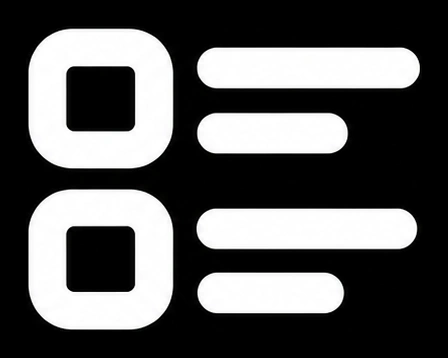
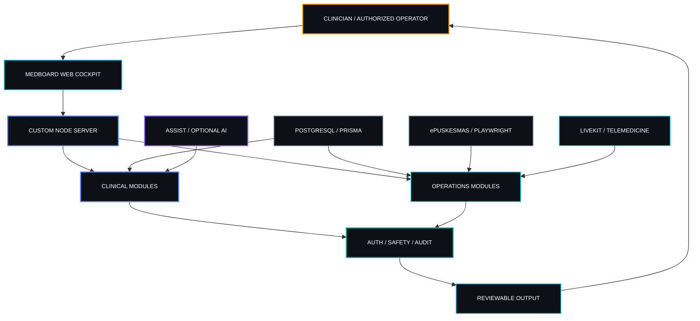
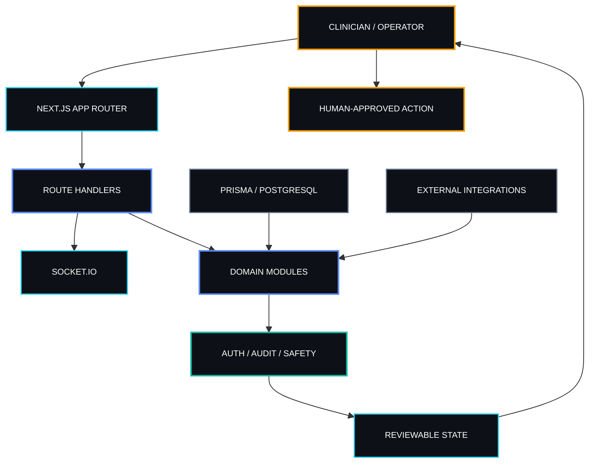
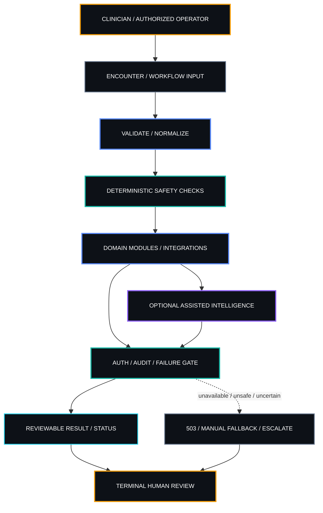
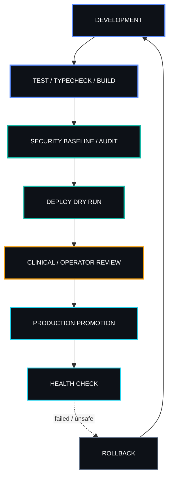

<table width="100%">
<tr>
<td width="34%" align="center" valign="middle">

<a href="https://medboard.sentrahai.com">
  
</a>
<br /><br />
<small><b><code>MEDBOARD</code></b></small><br />
<small>Clinical Smartboard · Sentra Healthcare Artificial Intelligence</small><br /><br />


</td>
<td width="66%" valign="top">

SENTRA / MEDBOARD

<a href="https://medboard.sentrahai.com">
  
</a>

<b>Operational signal:</b> Primary-care clinical operations · human-governed decision support

<a href="https://sentrahai.com/"><b>Sentra Artificial Intelligence</b></a><br />
Clinical Smartboard connecting clinical workflow, EMR integration, real-time coordination, reporting, telemedicine, and auditable decision support.

<small>Architected and built by <b>dr. Ferdi Iskandar (the Gaffer)</b>.</small>

<p>
  <a href="https://github.com/drferdi/Medboard" title="GitHub"></a>&nbsp;&nbsp;
  <a href="https://ferdiiskandar.com" title="ferdiiskandar.com"></a>&nbsp;&nbsp;
  <a href="https://sentrahai.com/" title="Sentra Artificial Intelligence"></a>&nbsp;&nbsp;
  <a href="https://medium.com/@drferdiiskandar" title="Medium"></a>&nbsp;&nbsp;
  <a href="https://orcid.org/0009-0003-3788-1307" title="ORCID"></a>&nbsp;&nbsp;
  <a href="https://www.linkedin.com/in/dr-ferdi-iskandar-1b620a3b5"></a>
</p>

<sub><code>CLINICAL SIGNAL → WORKFLOW → VERIFICATION → HUMAN AUTHORITY → CARE ACTION</code></sub>

</td>
</tr>
</table>

<p align="center">
  
  
  
  
  
  
</p>
01 / ORIGIN SIGNAL

MedBoard exists to reduce fragmentation across the primary-care operating surface: clinical capture, coding/reference work, operational coordination, reporting, EMR transfer, telemedicine, and reviewable decision support.

The repository is a **Next.js 16 / React 19 / TypeScript** application running behind a custom **Node.js 24** server. It uses **Socket.IO** for real-time channels, **Prisma + PostgreSQL** for persistence, **Playwright** for ePuskesmas workflow automation, **LiveKit** for telemedicine integration, and explicit security/audit controls.

The machine-readable lifecycle contract is <code>project.contract.json</code>: product ID <code>healthcare/medboard</code>, risk class **R2**, Node 24, pnpm 11.21.0, executable lifecycle commands, HTTP smoke expectations, and declared external dependencies.

> **Doctrine:** MedBoard may assist, structure, transfer, calculate, summarize, alert, and coordinate. Final diagnosis, treatment, prescribing, referral, and emergency escalation remain the responsibility of an accountable licensed clinician.

<table>
<tr>
<td width="33%" valign="top"><small><b><code>LAYER I · CLINICAL SURFACE</code></b></small><br /><br /><small>EMR workspace, ICD-X, calculators, Sentrapedia, telemedicine, reporting, audit and intelligence surfaces.</small></td>
<td width="33%" valign="top"><small><b><code>LAYER II · INTEGRATION & COORDINATION</code></b></small><br /><br /><small>Socket.IO, Playwright ePuskesmas transfer, LiveKit, messaging/email hooks, optional AI providers.</small></td>
<td width="33%" valign="top"><small><b><code>LAYER III · SAFETY & AUTHORITY</code></b></small><br /><br /><small>Authentication, role checks, audit trails, deterministic safety checks, degraded-state behavior, verification gates.</small></td>
</tr>
</table>

02 / DOCTRINE

> [!IMPORTANT]
> **Technology enables; clinicians decide.**

<table>
<tr>
<td width="50%" valign="top"><small><b><code>HUMAN AUTHORITY IS TERMINAL</code></b></small><br /><br /><small>Decision support must terminate at an accountable human reviewer. Automation cannot silently become clinical authority.</small></td>
<td width="50%" valign="top"><small><b><code>STATE MUST BE HONEST</code></b></small><br /><br /><small>Unavailable, retired, or unconfigured services must expose that state explicitly. A 503 is safer than simulated confidence.</small></td>
</tr>
<tr>
<td width="50%" valign="top"><small><b><code>PHI STAYS BOUNDED</code></b></small><br /><br /><small>Production secrets and patient data belong in controlled runtime systems, not source control, fixtures, screenshots, or unrestricted logs.</small></td>
<td width="50%" valign="top"><small><b><code>AUTOMATION MUST BE REVIEWABLE</code></b></small><br /><br /><small>RPA, real-time events, AI-supported paths, reporting, and integrations need observable inputs, outputs, failure modes, and manual fallback.</small></td>
</tr>
<tr>
<td width="50%" valign="top"><small><b><code>SOURCE OUTRANKS STORY</code></b></small><br /><br /><small>Executable behavior, package manifests, project contracts, tests, and route code outrank stale prose when documentation disagrees.</small></td>
<td width="50%" valign="top"><small><b><code>NO MAGIC WITHOUT AUDIT</code></b></small><br /><br /><small>A generated answer is not evidence. Verification, authorization, auditability, and accountable review are part of the product.</small></td>
</tr>
</table>

03 / PRODUCT TOPOLOGY

<p align="center">
  
  
  
  
  
  
</p>

<p align="center">
  
</p>

<details open>
<summary><b><code>LIVE TOPOLOGY // SYSTEM RELATION MAP</code></b></summary>



</details>

<table width="100%">
<tr>
<td width="50%" valign="top">
<small><b><code>01 · CLINICAL COCKPIT</code></b></small><br />
<small>Primary operating surface spanning encounter workflow, patient-facing clinical data, crew access, audit visibility, and supporting operational routes.</small>
</td>
<td width="50%" valign="top">
<small><b><code>02 · EMR TRANSFER</code></b></small><br />
<small>Playwright-backed ePuskesmas bridge with field mappings, transfer orchestration, queue/history support, socket progress, and handlers for anamnesis, diagnosis, and prescription workflows.</small>
</td>
</tr>
<tr>
<td width="50%" valign="top">
<small><b><code>03 · ICD-X & CLINICAL REFERENCE</code></b></small><br />
<small>ICD lookup surfaces, clinical reference content, Sentrapedia routes, contribution/review helpers, and structured knowledge access for day-to-day care workflows.</small>
</td>
<td width="50%" valign="top">
<small><b><code>04 · VITALS & EARLY WARNING</code></b></small><br />
<small>Unified vital-sign handling, instant red alerts, AVPU/GCS mapping, composite deterioration, NEWS2-related testing, and bedside risk signals implemented in source.</small>
</td>
</tr>
<tr>
<td width="50%" valign="top">
<small><b><code>05 · TRAJECTORY & PREDICTION</code></b></small><br />
<small>Clinical trajectory analysis, personal baseline logic, momentum scoring, convergence detection, prediction helpers, chronic-disease classification, and deterioration-oriented utilities.</small>
</td>
<td width="50%" valign="top">
<small><b><code>06 · MEDICAL CALCULATORS</code></b></small><br />
<small>Dedicated calculator surface and reusable medical-calculator library for structured bedside calculations inside the MedBoard workflow.</small>
</td>
</tr>
<tr>
<td width="50%" valign="top">
<small><b><code>07 · TELEMEDICINE</code></b></small><br />
<small>LiveKit-backed virtual consultation with RBAC, slots, token issuance, device checks, consult validation/dedupe, notifications, transcript/audio helpers, and bridge handoff logic.</small>
</td>
<td width="50%" valign="top">
<small><b><code>08 · REPORTING & LB1</code></b></small><br />
<small>Clinical report generation/store, activity reporting, LB1 engine, ICD-10 2010 mapping, template writing, history, XLSX/RME export, and report API surfaces.</small>
</td>
</tr>
<tr>
<td width="50%" valign="top">
<small><b><code>09 · CREW ACCESS & PRESENCE</code></b></small><br />
<small>Session-based crew access, roles/professions/institutions, profiles, registration, presence, directory/hub surfaces, doctor contacts, and online-status tracking.</small>
</td>
<td width="50%" valign="top">
<small><b><code>10 · ADMIN & OPERATIONS</code></b></small><br />
<small>Admin console routes, institution/staff surfaces, NOTAM operational notices, usage tracking, developer updates, geographic staff views, and controlled operational data paths.</small>
</td>
</tr>
<tr>
<td width="50%" valign="top">
<small><b><code>11 · REAL-TIME COORDINATION</code></b></small><br />
<small>Socket.IO-backed crew, chat/ACARS, presence, EMR relay, telemedicine bridge, and intelligence-event channels hosted by the custom Node server.</small>
</td>
<td width="50%" valign="top">
<small><b><code>12 · INTELLIGENCE & OBSERVABILITY</code></b></small><br />
<small>Intelligence dashboard adapters, AI-insight rendering, disclosure state, runtime observability, Socket.IO payload handling, and Sentry privacy-aware telemetry configuration.</small>
</td>
</tr>
<tr>
<td width="50%" valign="top">
<small><b><code>13 · SECURITY & AUDIT</code></b></small><br />
<small>Security audit logging, clinical-case audit, screening audit service, immutable screening hash chain, CORS helpers, rate limiting, secret scanning, dependency audit, and auth-hardening tests.</small>
</td>
<td width="50%" valign="top">
<small><b><code>14 · VOICE SURFACE</code></b></small><br />
<small>Voice chat/token/TTS lanes are explicitly disabled with 503 behavior during the current re-baseline; STT remains implemented through Groq Whisper when configured.</small>
</td>
</tr>
<tr>
<td width="50%" valign="top">
<small><b><code>15 · DECISION-SUPPORT BOUNDARY</code></b></small><br />
<small>The legacy MedBoard diagnosis engine remains in source but is retired by default. Its route returns 503 unless deliberately re-enabled; the retirement contract names MIRA through Assist as the differential source.</small>
</td>
<td width="50%" valign="top">
<small><b><code>16 · HEALTH & RELEASE SIGNALS</code></b></small><br />
<small>Health-check API, build/test/security commands, deploy dry-run script, project contract smoke expectations, CI security baseline, and documented rollback path provide operational verification surfaces.</small>
</td>
</tr>
</table>

04 / THE ENGINE ROOM

<small><code>IMPLEMENTED SOURCE SURFACE · STATUS-AWARE · EVIDENCE-FIRST</code></small>

<table width="100%">
<tr>
<td width="50%" valign="top"><small><b><code>APP ROUTER & UI</code></b></small><br /><small>`src/app` carries cockpit pages for EMR, audit, calculators, chat, dashboard, hub, ICD-X, patient flow, reports, Sentrapedia, telemedicine, voice, administration, and related route groups.</small></td>
<td width="50%" valign="top"><small><b><code>CUSTOM SERVER</code></b></small><br /><small>`server.ts` is the runtime entry point for the combined Next.js handler and Socket.IO server. Production does not rely on a plain `next start` path.</small></td>
</tr>
<tr>
<td width="50%" valign="top"><small><b><code>DATA PLANE</code></b></small><br /><small>Prisma Client + adapter-pg target PostgreSQL. Migrations, seed logic, database utilities, typed persistence, and selected runtime-state files support operational workflows.</small></td>
<td width="50%" valign="top"><small><b><code>AUTHORIZATION</code></b></small><br /><small>Crew sessions, role checks, institution/profession context, WebAuthn support, protected Socket.IO middleware, rate-limit helpers, and authorization-mode auditing define the access boundary.</small></td>
</tr>
<tr>
<td width="50%" valign="top"><small><b><code>CLINICAL UTILITY LAYER</code></b></small><br /><small>Trajectory, momentum, prediction, convergence, chronic-disease classification, formulary/therapy helpers, anamnesis extraction, vitals processing, and calculators are separated into inspectable modules.</small></td>
<td width="50%" valign="top"><small><b><code>RPA / BRIDGE LAYER</code></b></small><br /><small>Playwright filler, bridge mapper, queue, source trace, visit history, field mappings, transfer orchestrator, and workflow handlers implement the ePuskesmas transfer lane.</small></td>
</tr>
<tr>
<td width="50%" valign="top"><small><b><code>TELEMEDICINE LAYER</code></b></small><br /><small>LiveKit token/session support is combined with consult validation, deduplication, device checks, vital-sign handling, notifications, transcript audio, MIRA differential helper, and EMR bridge mapping.</small></td>
<td width="50%" valign="top"><small><b><code>REPORTING LAYER</code></b></small><br /><small>Clinical reporting and LB1 modules cover report generation/storage, clinical activity, ICD mapping, transformations, template writing, history, and spreadsheet/RME export behavior.</small></td>
</tr>
<tr>
<td width="50%" valign="top"><small><b><code>OBSERVABILITY LAYER</code></b></small><br /><small>Intelligence runtime observability, Sentry configuration with PHI-oriented scrubbing, event payload handling, health signals, and audit records expose operational state.</small></td>
<td width="50%" valign="top"><small><b><code>VERIFICATION LAYER</code></b></small><br /><small>Capsule tests, auth-hardening, protected-CDSS checks, engine tests, NEWS2 checks, Symphony safety gates, TypeScript no-emit validation, production build, audit commands, and deploy dry-run are executable gates.</small></td>
</tr>
</table>

<p align="center">
  
</p>

<details open>
<summary><b><code>RUNTIME TOPOLOGY // CONTROL & DATA PLANE</code></b></summary>



</details>

<small><b>Operational status matters:</b> source presence does not equal deployed availability. Optional providers require runtime configuration; retired/disabled paths intentionally expose degraded states instead of simulating service.</small>

05 / SIGNAL PATH

<details open>
<summary><b><code>SIGNAL PATH // HUMAN AUTHORITY MAP</code></b></summary>



</details>

> [!IMPORTANT]
> **Clinical authority is terminal.** MedBoard can structure, detect, summarize, transfer, calculate, and assist; an accountable clinician owns final diagnosis, treatment, prescribing, referral, and emergency escalation.

06 / BUILD PROTOCOL

<table width="100%">
<tr>
<td width="50%" valign="top"><small><b><code>BASE RUNTIME</code></b></small><br /><small>Node.js 24 · pnpm 11.21.0 through Corepack · Next.js 16.3.8 · React 19.2.3 · TypeScript 5.9.3.</small></td>
<td width="50%" valign="top"><small><b><code>DATABASE</code></b></small><br /><small>PostgreSQL is required for database-backed workflows. Prisma generation/migrations are explicit lifecycle steps.</small></td>
</tr>
<tr>
<td width="50%" valign="top"><small><b><code>OPTIONAL SERVICES</code></b></small><br /><small>LiveKit, Resend, WhatsApp Cloud API, Sentry, Groq, DeepSeek, Perplexity, OpenRouter, and related integrations activate only when their runtime configuration is present.</small></td>
<td width="50%" valign="top"><small><b><code>PRODUCTION SHAPE</code></b></small><br /><small>Deployment documentation uses Ubuntu/Caddy/systemd/Node 24/PostgreSQL with the application behind HTTPS/WebSocket reverse proxying.</small></td>
</tr>
</table>

Local development:

```bash
git clone https://github.com/drferdi/Medboard.git
cd Medboard
corepack enable
pnpm install --frozen-lockfile
cp .env.example .env.local
pnpm run prisma:generate
pnpm run db:migrate
pnpm run dev
```

Verification surface:

```bash
pnpm run test:capsule
pnpm run lint
pnpm run build
pnpm run security:baseline
pnpm run security:audit
pnpm run security:secret-scan
pnpm run security:catch-scan
pnpm run deploy:dry-run
pnpm run check
```

> [!NOTE]
> The repository script named `lint` is the TypeScript no-emit check. `project.contract.json` records that no separate linter command is configured.

<details open>
<summary><b><code>PROMOTION STATE // DEVELOPMENT → PRODUCTION</code></b></summary>



</details>

`project.contract.json` defines the standalone lifecycle and an HTTP smoke expectation on `127.0.0.1:4344/` with expected status `200`. Production deployment documentation separately targets the MedBoard service behind Caddy/systemd and includes rollback and backup procedures.

07 / THE SENTRA OPERATING STANDARD

No magic without audit.  
No automation without verification.  
No production promotion without rollback.  
No sensitive data without explicit security boundaries.  
No clinical authority without an accountable human reviewer.

<table width="100%">
<tr><td width="34%" valign="top"><small><b><code>PROBLEM</code></b></small></td><td width="66%" valign="top"><small>Fragmented primary-care workflow, duplicate entry, disconnected clinical signals, and operational coordination spread across multiple systems.</small></td></tr>
<tr><td width="34%" valign="top"><small><b><code>ACCOUNTABLE REVIEWER</code></b></small></td><td width="66%" valign="top"><small>The treating licensed clinician for clinical decisions; authorized operators for operational workflows; Chief retains authority over high-impact clinical logic and production-impact decisions.</small></td></tr>
<tr><td width="34%" valign="top"><small><b><code>OUT OF SCOPE</code></b></small></td><td width="66%" valign="top"><small>Autonomous diagnosis/treatment authority, unsupervised prescribing or referral, silent production changes, and repository storage of real PHI or production secrets.</small></td></tr>
<tr><td width="34%" valign="top"><small><b><code>FAILURE SURFACE</code></b></small></td><td width="66%" valign="top"><small>External services, database/configuration, authentication, network connectivity, RPA selectors, target-system changes, telemedicine infrastructure, optional providers, and downstream systems.</small></td></tr>
<tr><td width="34%" valign="top"><small><b><code>VERIFICATION</code></b></small></td><td width="66%" valign="top"><small>Executable tests, TypeScript validation, build gate, security baseline, dependency audit, secret/catch scans, deployment dry run, health checks, audit evidence, and explicit human review.</small></td></tr>
</table>

08 / SENTRA FOUNDATION · AGENT-FIRST ENGINEERING

MedBoard is developed inside the **Sentra Artificial Intelligence** engineering ecosystem.

**Human-Governed · Agent-Executed · Machine-Enforced.**

<table width="100%">
<tr>
<td width="50%" valign="top"><small><b><code>PROJECT CONTRACT</code></b></small><br /><small>`project.contract.json` declares `healthcare/medboard`, risk class `R2`, Node 24, pnpm 11.21.0, executable lifecycle commands, smoke behavior, external dependencies, and mutable-state paths.</small></td>
<td width="50%" valign="top"><small><b><code>AGENT BOUNDARY</code></b></small><br /><small>Agents may implement and verify inside authorized scope. Clinical authority and high-impact production decisions remain human-governed and non-delegable.</small></td>
</tr>
<tr>
<td width="50%" valign="top"><small><b><code>MACHINE ENFORCEMENT</code></b></small><br /><small>Scripts, tests, CI, security checks, runtime authorization, build gates, and smoke/health signals provide executable evidence rather than policy-only assurance.</small></td>
<td width="50%" valign="top"><small><b><code>EVIDENCE ORDER</code></b></small><br /><small>Current source/configuration and executable checks outrank stale prose. Disabled or retired paths must be documented as such instead of inferred from legacy code presence.</small></td>
</tr>
</table>

<p align="center">
  
  
  
  
</p>

09 / SENTRA DIVISIONAL HOME

<table width="100%">
<tr>
<td width="50%" valign="top">
<br /><br />
<small><b><code>SENTRA HEALTHCARE ARTIFICIAL INTELLIGENCE</code></b></small><br />
<small>Healthcare systems, clinical intelligence, operational support, and human-governed decision-support products within Sentra Artificial Intelligence.</small>
</td>
<td width="50%" valign="top">
<br /><br />
<small><b><code>MEDBOARD</code></b></small><br />
<small>Primary-care clinical operations cockpit with explicit separation between automation, decision support, verification, and clinician authority.</small>
</td>
</tr>
</table>

10 / OFFICIAL SPONSOR & INSTITUTIONAL CONTEXT

No external sponsor is declared by this repository. MedBoard is developed under **Sentra Artificial Intelligence**.

<table width="100%">
<tr>
<td width="50%" valign="top"><small><b><code>DOCUMENTED OPERATIONAL CONTEXT</code></b></small><br /><small>Repository architecture/deployment documentation identifies UPTD Puskesmas PONED Balowerti, Kota Kediri as an operational/deployment context.</small></td>
<td width="50%" valign="top"><small><b><code>CLAIM BOUNDARY</code></b></small><br /><small>This repository statement does not by itself establish sponsorship, certification, ownership, endorsement, or current deployment availability beyond the documented context.</small></td>
</tr>
<tr>
<td width="50%" valign="top"><small><b><code>DOCUMENTED TARGET</code></b></small><br /><small>Deployment documentation targets `medboard.sentrahai.com` with Caddy, systemd, Node 24, PostgreSQL, persistent runtime state, rollback, and backup procedures.</small></td>
<td width="50%" valign="top"><small><b><code>VERIFICATION RULE</code></b></small><br /><small>Live status is not inferred from README text. Verify environment health, current release state, service configuration, and operator approval before treating a deployment claim as current.</small></td>
</tr>
</table>

11 / OPEN CHANNEL

<p align="center">
  <a href="https://github.com/drferdi/Medboard"></a>
  <a href="https://ferdiiskandar.com"></a>
  <a href="https://www.linkedin.com/in/dr-ferdi-iskandar-1b620a3b5"></a>
</p>

<table width="100%">
<tr><td width="34%" valign="top"><small><b><code>ARCHITECTURE</code></b></small></td><td width="66%" valign="top"><small><a href="./ARCHITECTURE.md">ARCHITECTURE.md</a> · <a href="./docs/architecture.md">docs/architecture.md</a></small></td></tr>
<tr><td width="34%" valign="top"><small><b><code>FEATURES & API</code></b></small></td><td width="66%" valign="top"><small><a href="./docs/FEATURES.md">docs/FEATURES.md</a> · <a href="./docs/API.md">docs/API.md</a></small></td></tr>
<tr><td width="34%" valign="top"><small><b><code>CLINICAL LOGIC</code></b></small></td><td width="66%" valign="top"><small><a href="./docs/CLINICAL_LOGIC.md">docs/CLINICAL_LOGIC.md</a> · <a href="./docs/AI_GOVERNANCE.md">docs/AI_GOVERNANCE.md</a></small></td></tr>
<tr><td width="34%" valign="top"><small><b><code>DATA & PRIVACY</code></b></small></td><td width="66%" valign="top"><small><a href="./docs/DATA_MODEL.md">docs/DATA_MODEL.md</a> · <a href="./DATA_PRIVACY.md">DATA_PRIVACY.md</a> · <a href="./docs/PRIVACY.md">docs/PRIVACY.md</a></small></td></tr>
<tr><td width="34%" valign="top"><small><b><code>SECURITY</code></b></small></td><td width="66%" valign="top"><small><a href="./SECURITY.md">SECURITY.md</a> · vulnerability reports are handled privately according to that policy.</small></td></tr>
<tr><td width="34%" valign="top"><small><b><code>SETUP & DEPLOYMENT</code></b></small></td><td width="66%" valign="top"><small><a href="./docs/SETUP.md">docs/SETUP.md</a> · <a href="./docs/DEPLOYMENT.md">docs/DEPLOYMENT.md</a> · <a href="./docs/deploy-vps.md">docs/deploy-vps.md</a></small></td></tr>
<tr><td width="34%" valign="top"><small><b><code>TESTING & SUPPORT</code></b></small></td><td width="66%" valign="top"><small><a href="./docs/testing.md">docs/testing.md</a> · <a href="./docs/TROUBLESHOOTING.md">docs/TROUBLESHOOTING.md</a> · <a href="./CHANGELOG.md">CHANGELOG.md</a></small></td></tr>
<tr><td width="34%" valign="top"><small><b><code>CONTRIBUTION & LICENSE</code></b></small></td><td width="66%" valign="top"><small><a href="./CONTRIBUTING.md">CONTRIBUTING.md</a> · <a href="./CODE_OF_CONDUCT.md">CODE_OF_CONDUCT.md</a> · <a href="./LICENSE">LICENSE</a> · <a href="./DISCLAIMER.md">DISCLAIMER.md</a></small></td></tr>
</table>

MedBoard is dual-licensed under the terms in `LICENSE`. Review those terms before reuse, redistribution, organizational deployment, or commercial operation.

12 / ACTIVE STACK

<table width="100%">
<tr>
<td width="50%" valign="top">
  <a href="https://nextjs.org/"></a><br />
  
  <br />
  <small><b>Next.js</b></small><br />
  <small>App Router application shell, server rendering, route handlers, build output, and browser-facing MedBoard surfaces.</small><br />
  <small><a href="https://nextjs.org/">nextjs.org ↗</a></small>
</td>
<td width="50%" valign="top">
  <a href="https://nodejs.org/"></a><br />
  
  <br />
  <small><b>Node.js</b></small><br />
  <small>Runtime pinned by the project contract and package engines; hosts the custom Next.js + Socket.IO server through TSX.</small><br />
  <small><a href="https://nodejs.org/">nodejs.org ↗</a></small>
</td>
</tr>
<tr>
<td width="50%" valign="top">
  <a href="https://www.postgresql.org/"></a><br />
  
  <br />
  <small><b>PostgreSQL</b></small><br />
  <small>Primary relational persistence target for database-backed workflows, migrations, crew/security records, and application state.</small><br />
  <small><a href="https://www.postgresql.org/">postgresql.org ↗</a></small>
</td>
<td width="50%" valign="top">
  <a href="https://www.prisma.io/"></a><br />
  
  <br />
  <small><b>Prisma</b></small><br />
  <small>Typed database client, PostgreSQL adapter, schema/migration lifecycle, generation step, and seed integration.</small><br />
  <small><a href="https://www.prisma.io/">prisma.io ↗</a></small>
</td>
</tr>
<tr>
<td width="50%" valign="top">
  <a href="https://socket.io/"></a><br />
  
  <br />
  <small><b>Socket.IO</b></small><br />
  <small>Real-time transport for presence, chat/ACARS, EMR relay, telemedicine coordination, and intelligence-event channels.</small><br />
  <small><a href="https://socket.io/">socket.io ↗</a></small>
</td>
<td width="50%" valign="top">
  <a href="https://playwright.dev/"></a><br />
  
  <br />
  <small><b>Playwright</b></small><br />
  <small>Browser automation substrate for ePuskesmas transfer and browser-driven operational workflows, with explicit queue/history/failure handling.</small><br />
  <small><a href="https://playwright.dev/">playwright.dev ↗</a></small>
</td>
</tr>
<tr>
<td width="50%" valign="top">
  <a href="https://livekit.io/"></a><br />
  
  <br />
  <small><b>LiveKit</b></small><br />
  <small>Client/server video infrastructure used by telemedicine routes when the required LiveKit configuration is available.</small><br />
  <small><a href="https://livekit.io/">livekit.io ↗</a></small>
</td>
<td width="50%" valign="top">
  <a href="https://sentry.io/"></a><br />
  
  <br />
  <small><b>Sentry</b></small><br />
  <small>Error/operational observability with repository-defined PHI scrubbing behavior and session replay disabled by security configuration.</small><br />
  <small><a href="https://sentry.io/">sentry.io ↗</a></small>
</td>
</tr>
<tr>
<td width="50%" valign="top">
  <a href="https://groq.com/"></a><br />
  
  <br />
  <small><b>Groq</b></small><br />
  <small>The current STT route sends authenticated audio to Groq Whisper when `GROQ_API_KEY` is configured; failures are recorded in the security audit path.</small><br />
  <small><a href="https://groq.com/">groq.com ↗</a></small>
</td>
<td width="50%" valign="top">
  <a href="https://github.com/features/actions"></a><br />
  
  <br />
  <small><b>GitHub Actions</b></small><br />
  <small>Repository CI provisions PostgreSQL, installs dependencies deterministically, applies Prisma migrations, and runs the security baseline workflow.</small><br />
  <small><a href="https://github.com/features/actions">github.com/features/actions ↗</a></small>
</td>
</tr>
<tr>
<td width="50%" valign="top">
  <a href="https://pnpm.io/"></a><br />
  
  <br />
  <small><b>pnpm</b></small><br />
  <small>Package manager pinned by `packageManager`, used by the project contract and repository scripts for install, test, build, start, and verification commands.</small><br />
  <small><a href="https://pnpm.io/">pnpm.io ↗</a></small>
</td>
<td width="50%" valign="top">
  <br />
  
  
  
  <br />
  <small><b><code>STACK POSTURE</code></b></small><br />
  <small>Evidence-first, audit-first, explicit about unavailable states, and governed by terminal human authority for clinical decisions.</small>
</td>
</tr>
</table>

13 / INSTRUMENTATION

<small><code>ACTUAL TECHNOLOGY SURFACE · 10 ENGINEERING PILLARS · MEDBOARD</code></small>

<table width="100%">
<tr>
<td width="50%" valign="top">
<br /><br />
<small><b><code>LANGUAGES & RUNTIMES</code></b></small><br />
<small>TypeScript 5.9.3 · Node.js 24 · JavaScript/MJS utility scripts · SQL/PostgreSQL · Bash/systemd deployment commands · HTML/CSS UI surface.</small>
</td>
<td width="50%" valign="top">
<br /><br />
<small><b><code>FRONTEND & UI</code></b></small><br />
<small>Next.js 16.3.8 App Router · React 19.2.3 · Tailwind CSS 4.2.1 · IBM Plex Sans/Mono · Lucide React · Chart.js / react-chartjs-2 · Leaflet / react-leaflet · Motion · Tweakpane.</small>
</td>
</tr>
<tr>
<td width="50%" valign="top">
<br /><br />
<small><b><code>BACKEND & API</code></b></small><br />
<small>Custom Node server · Next.js route handlers · Socket.IO server/client · Zod · server-only modules · Resend integration · typed service modules under `src/lib`.</small>
</td>
<td width="50%" valign="top">
<br /><br />
<small><b><code>CLINICAL INTELLIGENCE</code></b></small><br />
<small>Vitals red alerts · NEWS2-related checks · trajectory analyzer · momentum engine · prediction engine · convergence detector · disease classifiers · anamnesis extractor · calculators · formulary/therapy helpers · legacy CDSS source retained but retired by default.</small>
</td>
</tr>
<tr>
<td width="50%" valign="top">
<br /><br />
<small><b><code>DATABASE & STORAGE</code></b></small><br />
<small>PostgreSQL · Prisma Client 6.19.x · Prisma adapter-pg · pg 8.19 · migrations/seed · controlled runtime files for selected queues/history · XLSX/CSV/JSON reporting artifacts.</small>
</td>
<td width="50%" valign="top">
<br /><br />
<small><b><code>REAL-TIME & COMMUNICATION</code></b></small><br />
<small>Socket.IO crew/intelligence channels · LiveKit client/server telemedicine · Resend email · WhatsApp Cloud API hooks · online/presence tracking · notification helpers.</small>
</td>
</tr>
<tr>
<td width="50%" valign="top">
<br /><br />
<small><b><code>AI & AUTOMATION</code></b></small><br />
<small>Playwright RPA · MIRA-via-Assist retirement contract for differential diagnosis · Groq Whisper STT · telemedicine OpenRouter helper · optional DeepSeek / Perplexity / OpenRouter provider configuration · deterministic local safety paths where implemented.</small>
</td>
<td width="50%" valign="top">
<br /><br />
<small><b><code>TESTING & QA</code></b></small><br />
<small>TSX test suite · auth-hardening tests · protected-CDSS checks · CDSS engine tests · NEWS2 early-warning tests · Symphony safety-gate tests · unit tests across vitals/clinical/telemedicine/audit/intelligence · Playwright package · TypeScript no-emit · production build gate.</small>
</td>
</tr>
<tr>
<td width="50%" valign="top">
<br /><br />
<small><b><code>SECURITY & GOVERNANCE</code></b></small><br />
<small>Crew session authorization · clinical-role gates · WebAuthn server package · CORS allowlists · rate limiting · security audit log · immutable screening hash · secret scan · catch scan · pnpm audit · Semgrep command · PHI-aware Sentry scrubbing · SAFRS R2 contract · human clinical authority.</small>
</td>
<td width="50%" valign="top">
<br /><br />
<small><b><code>DEVOPS & OBSERVABILITY</code></b></small><br />
<small>GitHub Actions · Renovate · Corepack/pnpm · deployment dry-run · health API · Sentry · documented Ubuntu/Caddy/systemd VPS deployment · PostgreSQL service · persistent runtime directory · rollback and daily-backup procedures.</small>
</td>
</tr>
</table>

<p align="center">
  <br /><br />
  <b>Architected &amp; Built by dr. Ferdi Iskandar (the Gaffer)</b><br />
  Sentra Artificial Intelligence · Sentra Healthcare Artificial Intelligence<br />
  <sub><code>// the surface is documentation. the depth is running.</code></sub>
</p>
